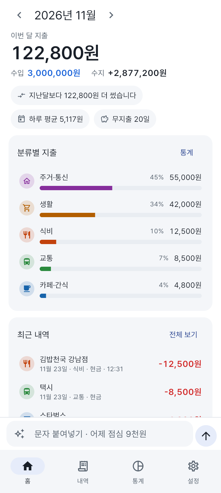
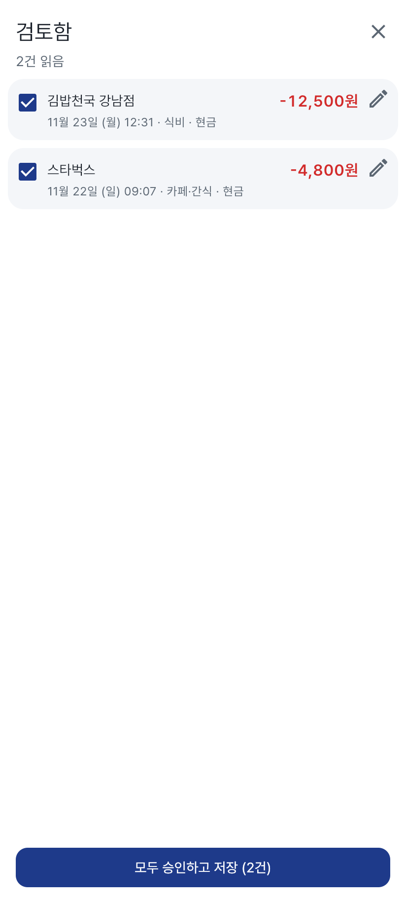
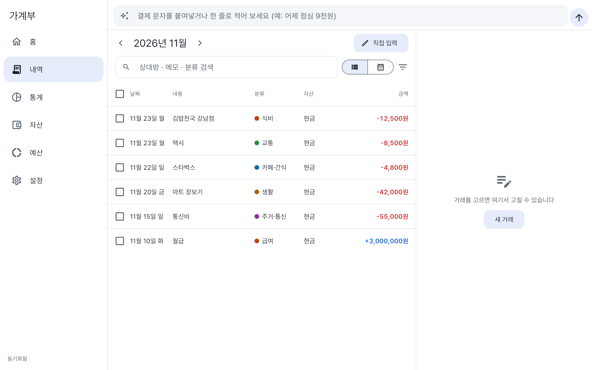

# 가계부

문자와 문장으로 적는 가계부다. Windows · Android · 웹에서 같은 화면을 쓰고, 결제 문자와 한 줄 문장을 **기기 안에서** 해석해 거래로 옮긴다. iPhone · iPad · Mac은 웹 앱으로 쓴다.

| 휴대폰 | 검토함 | PC |
| --- | --- | --- |
|  |  |  |

## 지금 상태

v0.1.0(2026-11-24). 웹 앱은 <https://kimhershey.github.io/gagyebu/>에서 쓴다. Android APK와 Windows 설치 파일은 릴리스 태그를 올리면 [Releases](https://github.com/kimhershey/gagyebu/releases)에 올라간다(아래 "릴리스").

"확인"은 세 가지로 가른다. **화면**은 웹 빌드를 실제 서버에 이어 눌러 본 것, **시험**은 자동 시험만 통과한 것, **빌드**는 CI에서 빌드만 된 것이다.

| 항목 | 확인 |
| --- | --- |
| 로그인(이메일 · 비밀번호), 계정 만들기, 로그아웃, 계정 삭제 | 화면 |
| 입력창 → 검토함 → 저장, 작업 기록과 되돌리기 | 화면 |
| 붙여넣기 해석(은행 · 카드 문자, 앱 알림 32개 형식), 한 줄 입력 | 화면 · 시험(골든 세트) |
| 홈, 내역(목록 · 달력 · 필터 · 일괄 수정), 통계 | 화면 |
| 자산, 분류, 예산, 반복 거래, 카드 결제 | 화면(열림) · 시험 |
| 자연어 조회("이번 달 식비 얼마야?") | 화면 |
| 명령창(`>`)과 단축키, 테마 여섯 가지 | 화면 |
| 서버 동기화(올리기 · 받기 · 충돌 기록) | 화면(올리기 · 삭제) · 시험 |
| 내보내기 · 가져오기(CSV, Excel), 앱 잠금, 첫 실행 안내 | 화면(열림) · 시험 |
| Google 로그인 | 시험. Google 화면으로 넘어가는 것까지 봤다 |
| 비밀번호 다시 정하기(메일) | 시험. 메일을 받아 보지는 못했다 |
| 실시간 신호(다른 기기의 변경을 바로 받기) | 시험(가짜 서버) |
| Android · Windows 앱 | 빌드. **기기에서 실행해 보지 못했다** |
| 기기 안의 모델(모르는 형식의 문자 읽기, 월별 총평) | 시험 · 빌드. 모델 카탈로그가 비어 있어 앱에서 내려받을 수 없다 |
| 이미지 입력(Windows) | 시험 · 빌드 |
| 공유로 받기(Android), 업데이트 알림 | 시험 · 빌드 |

찾은 오류와 남은 문제, 확인하지 못한 것은 [docs/ERRORS.md](docs/ERRORS.md)에 있다.

골든 세트의 일치율은 규칙을 만든 표본에 대한 회귀 검사다. 처음 보는 글에 대한 수치는 따로 지어낸 홀드아웃 표본으로 쟀고(`eval/README.md`), 모르는 형식의 문자에서 모든 항목이 맞은 초안은 규칙만 0/20, Qwen3.5-2B를 붙이면 13/20이었다. 실제 문자를 모아 다시 재야 한다.

## 폴더

```
app/                 Flutter 앱 (lib/, test/, tool/, android/, windows/, web/)
  lib/app/           앱 시작, 테마, 화면 이동, 상태 제공, 동기화 실행, 모델 엔진 고르기
  lib/core/          날짜, 형식, 창 너비 등급
  lib/domain/        열거형, 기본 분류, 월 기간, 월 집계, 카드 결제일
  lib/features/      화면: auth, shell, composer, review, history, command, home, transactions,
                     stats, accounts, categories, budget, recurring, query, image_input, models,
                     settings, lock, transfer, onboarding
  lib/ai/            입력 해석: 순서(input_interpreter), 규칙(text/), 모델(llm/), 이미지(vision/), 조회(query/)
  lib/data/          로컬 DB(db/), 저장소(repositories/), 동기화(sync/), 서버 연결(server/), 기기 설정(prefs/)
  lib/platform/      업데이트 확인, 공유로 받기
  tool/              웹 빌드 준비, 라이선스 검사, 해석 평가(llm_eval)
supabase/            서버 SQL과 시험, 동기화 규약 (supabase/README.md)
catalog/             앱이 읽는 공개 파일: 모델 카탈로그(models.json), 최신 버전(version.json)
installer/           Windows 설치 파일 스크립트(Inno Setup)
eval/                골든 세트 · 홀드아웃 표본, 생성 스크립트, 실측 기록
docs/                설계서(SPEC.md), 오류 기록(ERRORS.md), 개인정보 처리방침(PRIVACY.md), 화면
.github/workflows/   ci.yml(시험 · 서버 SQL · 빌드 · 웹 배포), release.yml(태그로 릴리스), backup.yml(백업)
```

설계 전체와 파일 구조는 [docs/SPEC.md](docs/SPEC.md)에 있다.

## 개발

Flutter 3.50.0(stable)을 쓴다.

```bash
cd app
flutter pub get
flutter test                              # Linux에서는 libsqlite3-dev가 필요하다
dart run tool/check_licenses.dart         # 의존성 라이선스 검사
```

웹으로 실행하려면 SQLite WebAssembly와 웹 워커를 먼저 준비한다.

```bash
cd app
dart run tool/prepare_web_assets.dart
flutter run -d chrome
```

배포용 웹 빌드는 엔진 파일을 앱과 함께 올린다. 앱이 다른 서버에 접속하지 않게 하기 위해서다.

```bash
cd app
flutter build web --release --no-web-resources-cdn
```

테이블을 고치면 생성 코드를 다시 만든다.

```bash
cd app
dart run build_runner build
```

푸시할 때마다 CI(`.github/workflows/ci.yml`)가 시험, 서버 SQL 검증, 웹 · Android · Windows 빌드를 돌린다. 실행 결과 페이지의 Artifacts에서 시험용 APK(`gagyebu-android-arm64`, 디버그 키 서명)와 Windows 실행 폴더(`gagyebu-windows-x64`)를 내려받을 수 있다.

서버(Supabase) 주소와 공개 키를 넣어 빌드하면 로그인과 동기화가 켜진다. 넣지 않으면 기기 안에서만 동작한다. 두 값은 공개해도 되는 값이고, service_role 키와 DB 비밀번호는 앱이나 저장소에 넣지 않는다.

```bash
cd app
flutter run -d chrome --dart-define=SUPABASE_URL=https://xxxx.supabase.co --dart-define=SUPABASE_PUBLISHABLE_KEY=sb_publishable_xxxx
```

CI는 저장소 변수 `SUPABASE_URL`과 `SUPABASE_PUBLISHABLE_KEY`를 읽어 같은 방식으로 빌드한다. 서버 쪽 준비(마이그레이션 적용, Google 로그인 설정)는 `supabase/README.md`에 있다.

서버 SQL은 임시 PostgreSQL 16 클러스터에서 시험한다.

```bash
supabase/tests/run_local.sh
```

문자 형식 표본을 더하거나 고치면 골든 세트를 다시 만든다.

```bash
python3 eval/tool/build_paste_golden.py
```

규칙과 모델이 처음 보는 표본을 얼마나 읽는지 잰다. 모델을 쓰는 모드는 `eval/README.md`를 본다.

```bash
cd app
dart run tool/llm_eval.dart --mode=rules --set=holdout
```

## 릴리스

`app/pubspec.yaml`의 `version`을 올려 커밋한 뒤 같은 버전의 태그를 올린다. 태그의 첫 줄은 앱의 업데이트 안내에 그대로 보인다.

```bash
git tag -a v0.2.0 -m "예산 화면을 더했습니다."
git push origin v0.2.0
```

`v*` 태그가 올라가면 `.github/workflows/release.yml`이 다음을 한다.

1. 태그와 `pubspec.yaml`의 버전이 같은지 본다. 다르면 멈춘다.
2. Android APK(`gagyebu-android-arm64.apk`)와 Windows 설치 파일(`gagyebu-setup.exe`, `installer/`)을 CI와 같은 방법으로 빌드한다.
3. 둘을 GitHub Releases에 올린다.
4. 앱이 업데이트를 확인할 때 읽는 `catalog/version.json`의 `latest`와 내려받기 주소를 그 태그로 고쳐 `main`에 커밋한다. `v0.2.0-beta.1`처럼 `-`가 든 태그는 시험판으로 올리고 이 파일은 건드리지 않는다.

저장소 비밀값(Settings → Secrets and variables → Actions)은 없어도 CI와 릴리스가 돈다. 넣으면 아래가 켜진다. 값은 저장소의 파일에 적지 않는다.

| 비밀값 | 쓰는 곳 | 없으면 |
| --- | --- | --- |
| `ANDROID_KEYSTORE_BASE64`, `ANDROID_KEYSTORE_PASSWORD`, `ANDROID_KEY_ALIAS`, `ANDROID_KEY_PASSWORD` | APK 서명(CI, 릴리스) | 디버그 키로 서명한다. 실행마다 키가 달라질 수 있어, 그렇게 만든 APK 위에는 다음 버전을 덮어 설치하지 못할 수 있다 |
| `SUPABASE_DB_URL`, `BACKUP_PASSPHRASE` | 서버 백업과 삭제 표시 정리(`.github/workflows/backup.yml`) | 건너뛴다 |

서명 키는 한 번 만들어 계속 쓴다. 키를 잃거나 바꾸면 이미 설치한 사람은 앱을 지웠다가 다시 깔아야 한다.

```bash
keytool -genkeypair -v -keystore gagyebu-release.jks -storetype PKCS12 \
  -keyalg RSA -keysize 2048 -validity 10000 -alias gagyebu
base64 -w 0 gagyebu-release.jks     # 이 출력이 ANDROID_KEYSTORE_BASE64 (macOS는 base64 -i gagyebu-release.jks)
```

`ANDROID_KEY_ALIAS`는 위의 `-alias` 값이다. PKCS12 형식은 키의 비밀번호가 키 파일의 비밀번호와 같으므로 `ANDROID_KEYSTORE_PASSWORD`와 `ANDROID_KEY_PASSWORD`에 같은 값을 넣는다. 키 파일과 비밀번호는 저장소 밖에도 보관한다.

키 파일(`*.jks`)은 저장소에 넣지 않는다(`.gitignore`에 있다). 백업을 켜는 방법과 복원 절차는 `supabase/README.md`의 "백업과 복원", 설치 파일을 PC에서 만드는 방법은 `installer/README.md`에 있다.

## 지키는 것

- 붙여넣은 원문과 이미지는 기기 밖으로 나가지 않는다. 서버에는 사용자가 확인해 저장한 거래와 설정만 올라간다.
- AI가 읽은 거래는 검토 카드에서 확인해야 저장된다. 금액과 날짜 계산은 모델이 아니라 규칙 코드가 한다. 모델은 규칙이 뽑은 후보 가운데에서 고르기만 한다.
- 모든 읽기와 쓰기는 기기의 로컬 DB에서 먼저 일어난다. 서버가 멈춰도 앱은 계속 쓸 수 있다.
- 웹 앱의 데이터는 그 브라우저 안에만 있다. 공유 워커가 없는 브라우저(Samsung Internet, 앱 안의 웹뷰 등)는 탭마다 DB 사본을 따로 들기 때문에, 나중에 연 탭만 쓰이고 먼저 열려 있던 탭은 멈춘다. 두 탭이 서로의 저장 내용을 덮어쓰는 것을 막기 위해서다.
- 라이브러리와 모델은 소스 공개 의무가 없는 허용형 라이선스만 쓴다(MIT · BSD · Apache-2.0 등). `tool/check_licenses.dart`가 CI에서 확인한다.
- 서버 테이블, 기기 테이블, 동기화 컬럼 목록은 같은 컬럼을 가져야 한다. `test/data/schema_contract_test.dart`가 어긋남을 잡는다.
